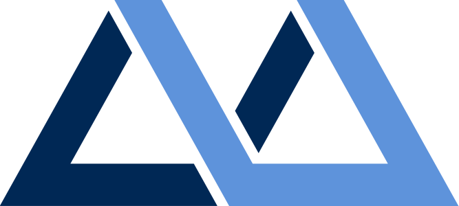
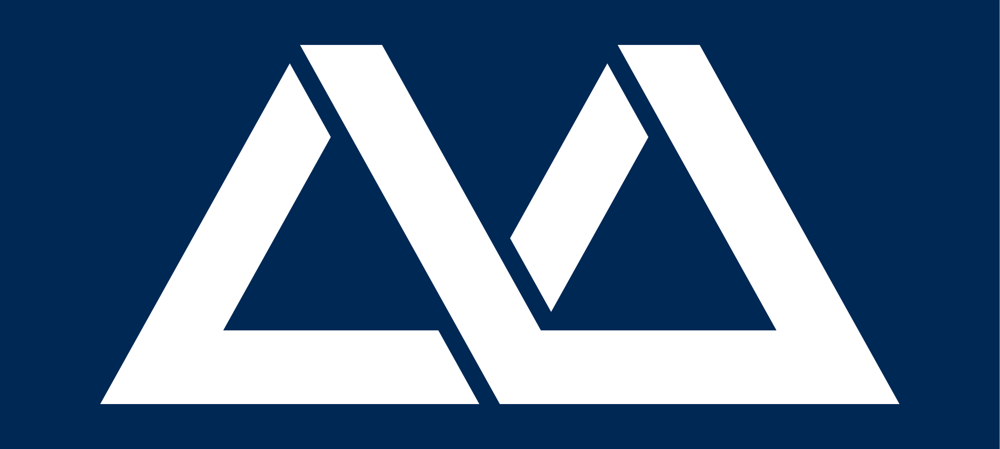

> [!CAUTION]
> No License on brand assets is given.
> We not annotated differently, reproduction only with prior authorization by PROPSTAT.

# Favicons

# Mask and Size

The safe zone is slightly smaller than 80% and should cover all applications with a circle mask.

| Description | File               |
|-------------|--------------------|
| Dark        |               |
|             |   SVG / PNG / ICO  |
| Transparent | INSERT Transparent |
|             |   SVG / PNG / ICO  |
| Sky Blue    |   INSERT Sky blue  |
|             | SVG / PNG / ICO    |
| Mask        | INSERT MASK LINK   |
|             | Vectorcraft File   |

|            | Regular                                                                                                                                                              | Dark                                                                                                                                                               |
| ---------- | ----------------------------------------------------------------------------------------------------------------------------------------------------------------- | ------------------------------------------------------------------------------------------------------------------------------------------------------------------- | 
| **Mask**   |                                                                    |                                                                     | 
|            | [SVG](https://github.com/propstat/propstat-brand/blob/main/logos/propstat-logo.svg) / [PNG](https://github.com/propstat/propstat-brand/blob/main/logos/propstat-logo.png)     | [SVG](https://github.com/propstat/propstat-brand/blob/main/logos/propstat-logo-dark.svg) / [PNG](https://github.com/propstat/propstat-brand/blob/main/logos/propstat-logo-dark.png)     |
| **Dark** |                                                                  |                                                                   | 
|            | [SVG](https://github.com/propstat/propstat-brand/blob/main/logos/propstat-logo-logomark.svg) / [PNG](https://github.com/propstat/propstat-brand/blob/main/logos/propstat-logo-logomark.png) | [SVG](https://github.com/propstat/propstat-brand/blob/main/logos/propstat-logo-logomark-dark.svg) / [PNG](https://github.com/propstat/propstat-brand/blob/main/logos/propstat-logo-logomark-dark.png) |
| **Sky Blue** |                                                                  |                                                                   | 
|            | [SVG](https://github.com/propstat/propstat-brand/blob/main/avatars/propstat-avatar-logo-skyblue.svg) / [PNG](https://github.com/propstat/propstat-brand/blob/main/avatars/propstat-avatar-logo-skyblue.png) | [SVG](https://github.com/propstat/propstat-brand/blob/main/avatars/propstat-avatar-logo-dark.svg) / [PNG](https://github.com/propstat/propstat-brand/blob/main/avatars/propstat-avatar-logo-dark.png) |