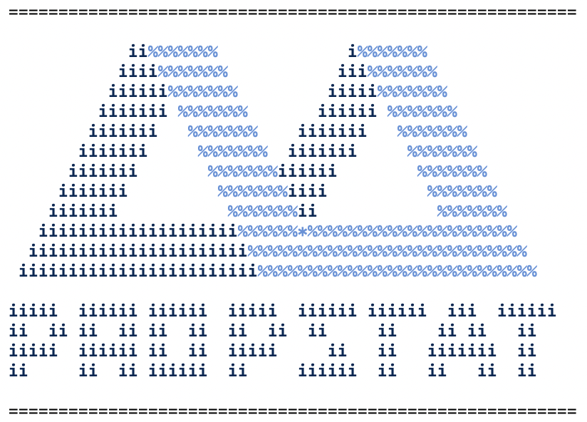

# Shell Usage of Propstat Colors and Logo

## Color Scheme 
```
# CI COLORS
PS_DARK_BLUE=$(printf '\033[38;2;0;40;85m')       # #002855
PS_LIGHT_BLUE=$(printf '\033[38;2;94;147;219m')   # #5E93DB
PS_GREY=$(printf '\033[38;2;63;68;68m')           # #3F4444
PS_SKY_BLUE=$(printf '\033[38;2;221;229;237m')    # #DDE5ED

# INTERFACE COLORS
PS_RED=$(printf '\033[38;2;218;41;28m')            # #DA291C
PS_ORANGE=$(printf '\033[38;2;253;170;99m')        # #FDAA63
PS_YELLOW=$(printf '\033[38;2;250;224;83m')        # #FAE053
PS_GREEN=$(printf '\033[38;2;92;170;127m')         # #5CAA7F

# TERMINAL FORMATTING
PS_BOLD=$(printf '\033[1m')
PS_DIM=$(printf '\033[2m')
NC=$(printf '\033[0m')
```
